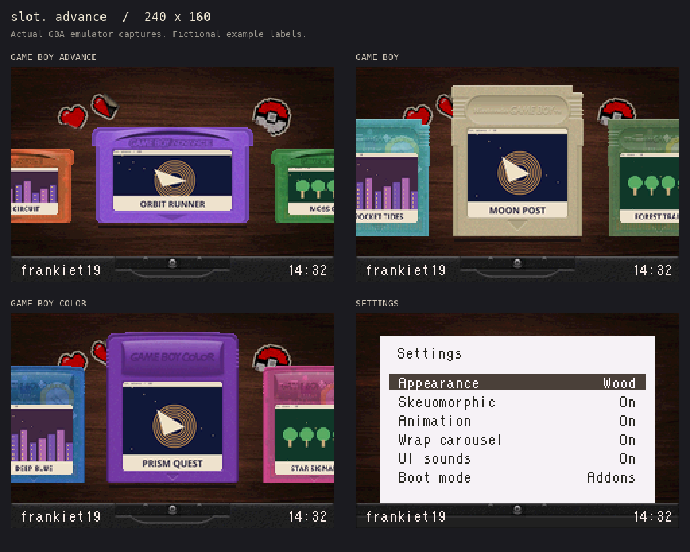

# slot. advance

**slot.'s cartridge frontend, brought to the Game Boy Advance.**

slot. advance is a port of [slot.](https://github.com/slot-cfw/slot) for **EZ-FLASH Omega** and the original **Omega Definitive Edition**, using [DS Style](https://github.com/FrankieT19/omega-de-ds-style-kernel) as its underlying framework. It brings slot.'s cartridge carousel, scanned labels, cartridge colours and insertion animation to the GBA's 240 × 160 screen. DS Style handles game loading, saves, native GBA patches and GB/GBC emulation.

**Version:** v1.0



The screenshots use fictional example labels in the compiled GBA preview.

## Download

Open [Releases](https://github.com/FrankieT19/slot-advance/releases) and download the ZIP for your cartridge. **Each model ZIP includes the Windows artwork converter.**

| Your cartridge | Download | Kernel inside `SD_CARD` |
| --- | --- | --- |
| Original EZ-FLASH Omega | `slot-advance-v1.0-omega.zip` | `ezkernel.bin` |
| Original Omega Definitive Edition, Rev A / Rev B | `slot-advance-v1.0-omega-de.zip` | `ezkernelnew.bin` |

The newer blue-PCB **Omega DE B / EZODE-B is not supported** by these backends. The two downloads are model-specific; do not rename one kernel to use it on the other model.

This first public package has automated and emulator checks. Physical-cartridge timing, save write-back and game compatibility still need verification on each supported hardware revision. Back up your card and saves before updating.

## Install

1. Extract the correct model ZIP on your computer. It contains `SD_CARD`, `Tools`, this guide and the licences.
2. Copy **the contents of `SD_CARD`** to the root of your SD card. Merge the `SYSTEM` folder with any existing one; keep your current files and saves. Do not copy the `SD_CARD` folder itself as a subfolder.
3. Put your unzipped games directly in `Games/GBA`, `Games/GB` and `Games/GBC`. Nested folders are not scanned. Use `.gba`/`.agb`, `.gb` and `.gbc` respectively.
4. If upgrading from DS Style, keep its existing `SYSTEM/SAVER` folder. If moving from a stock kernel with saves in a root `SAVER` folder, **copy** those saves into `SYSTEM/SAVER`, keeping their filenames and originals. GB/GBC use `.esv` saves; avoid giving GB and GBC games the same filename stem.
5. Follow the artwork setup below, or boot immediately with generated text labels and add artwork later.
6. With the correct kernel file at the SD root, use your cartridge's usual **hold R while powering on** update procedure. Follow the updater's prompts. Keep the required filename: `ezkernel.bin` or `ezkernelnew.bin`.
7. Start with a disposable/homebrew game and confirm a save survives a complete reboot before relying on important saves.

The kernel and built-in GB/GBC emulator are included. You do not need a separate DS Style installation. Existing additional DS Style system data can be kept. No game ROMs, personal saves or scraped commercial artwork are included.

Your card should look like this:

```text
SD root/
  ezkernelnew.bin          # or ezkernel.bin for the original Omega
  USERNAME.TXT            # optional; see Personalise below
  Games/
    GBA/Example.gba
    GB/Example.gb
    GBC/Example.gbc
  Labels/                 # original Cart Studio PNGs and shell choices
  SYSTEM/
    SAVER/
    SLOT/                 # converted artwork and saved preferences
```

## Get the labels and cartridge colours

Use the original [slot. Cart Studio](https://studio.slot-cfw.fyi/) to find artwork and choose cartridge colours. Then use the included converter to make the GBA-sized BMPs.

1. Put your games in the folders above before opening Cart Studio.
2. In Cart Studio, choose **Get Started**, then **Choose SD Card**. Select the **top of the card**, containing `Games`; do not select just `Games` or `Labels`.
3. Let Cart Studio identify your games. Use **Fill unlabelled carts…** and choose **Real Label** for scanned cartridge labels, or **Logo Only** if you prefer. Click an individual cartridge to change its label, upload your own PNG or choose its shell colour/finish.
4. Choose **Write to card**. In browsers that download instead, use **Download labels**, extract `labels.zip`, and merge its `Labels` folder into your SD root. Keep the shell metadata such as `Labels/cart_shell.txt`; it carries the cartridge choices.
5. Run **`Tools/slot-advance-label-converter-v1.0.exe`** from the release ZIP on your Windows computer. Choose **Select SD card…**, select the card root, then convert. The application includes everything it needs; no Python installation is required.
6. Wait for conversion to finish, safely eject the card, and boot your GBA.

The converter writes both realistic and simple cartridges to `SYSTEM/SLOT/CARTS` and `SYSTEM/SLOT/CARTS_FLAT`. It preserves your games, saves, original PNGs and shell metadata. You can rerun it after changing labels or adding games.

**Names must match.** `Games/GBA/Example.gba` goes with `Labels/GBA/Example.png`. Keep the original labels for future changes; detail already removed from an old BMP cannot be recovered without the original PNG. Labels use a tiny one-pixel corner cut at GBA resolution. Missing artwork gets a cartridge with the game's name in the native pixel font. Cart Studio's generated text labels are also redrawn at GBA resolution for clean lettering.

On macOS/Linux, the source download includes the Python converter; see [Building and running the tools](docs/BUILD.md). Cart Studio itself works in the browser. Its artwork keeps the terms of the original artwork sources.

## Personalise

Create **`USERNAME.TXT` at the SD-card root** and put your name on its first line:

```text
PlayerOne
```

The kernel reads it at startup and shows it at the **bottom left**, aligned opposite the clock. It displays at most **10 characters**, so the name stays clear of the cartridge slot. Use plain letters, numbers, spaces and punctuation; unsupported characters display as `?`. Save as plain text/UTF-8. Leave the file absent or empty for a blank footer. A `USERNAME.example.txt` template is included outside `SD_CARD`, so installing an update does not overwrite your name.

Press **Start → Settings** to choose Wood/Dark/Light, turn Skeuomorphic design on/off, enable sounds and animations, change boot options or open Help. Dark uses a black background; the simple design has no cartridge shadows.

## Controls

| Button | Action |
| --- | --- |
| Left / Right | Choose a game; hold for continuous scrolling |
| L / R or Up / Down | Change system shelf; empty shelves are skipped |
| A | Insert and launch the selected game |
| B | GBA boot options; return from a menu |
| Start | Settings |
| Settings: Up / Down | Choose an option |
| Settings: A / Left / Right | Change or open an option |
| Settings: B | Save and return |
| Help: Left / Right | Switch between frontend and in-game controls |

For **native GBA games booted with Addons**, hold **Select for about three seconds** to return to the kernel, or press **Start + Select** for the in-game menu. **Select hold** must be enabled for the hold-reset shortcut. Enable **Save states** for in-game save/load-state operations. These shortcuts do not apply to Clean boot or the built-in GB/GBC emulator; those use their own controls.

## Adding games and updating

The library is read automatically at startup and when changing shelves. To add games, power off, copy them into the correct folder, update their artwork if wanted, and boot again. Each system remembers its own selection.

For an update, back up the card, copy the new model's `SD_CARD` contents over your installation, and update the kernel with R as above. Preserve `SYSTEM/SAVER`, `Labels`, `USERNAME.TXT` and your existing settings. About and the download filenames show the release version.

## Troubleshooting

- **“No kernel found”:** check the cartridge model, the required kernel filename, and that the file is at the SD root rather than inside an `SD_CARD` subfolder.
- **Games missing:** unzip them, use the correct system folder, and avoid nested folders. The inherited limits are 512 games per shelf and 99 encoded bytes per filename, including the extension. Empty shelves are intentionally skipped.
- **Generic carts or wrong labels:** make sure PNG and ROM stems match, run the converter on the whole SD-card root, and keep the Cart Studio shell metadata. Check the converter's notes if it reports a problem.
- **Reset/menu shortcuts do nothing:** use native GBA Addon boot and check Select hold / Save states in Settings. Patch compatibility depends on the game; Clean boot remains available through B on a GBA cartridge.
- **A save seems missing:** keep the original backup and check that the correctly named save is in `SYSTEM/SAVER`. GB/GBC games share `.esv` save names, so use distinct game stems across those two shelves.

More technical limits and exact validation results are in [validation/REPORT.md](validation/REPORT.md). Build instructions and the source tools are in [docs/BUILD.md](docs/BUILD.md).

## Credits

- **slot. frontend and design:** [Brandon Kowalski and slot. contributors](https://github.com/slot-cfw/slot).
- **Skeuomorphic artwork:** [Markus](https://github.com/MarkusMaribu).
- **GBA port and DS Style framework:** [frankiet19](https://github.com/FrankieT19), building on the EZ-FLASH kernels, SimpleLight and their contributors.
- **Artwork preparation:** [slot. Cart Studio](https://github.com/slot-cfw/cart-studio-web).

slot. advance is an independent port, not an official slot. or EZ-FLASH release. The combined derivative is **GPL-3.0-or-later**; original files retain their notices, including DS Style/EZ-FLASH's Apache-2.0 notices. See [LICENSE](LICENSE) and [NOTICE.md](NOTICE.md). Releases contain no commercial ROMs or scraped game-label packs.
